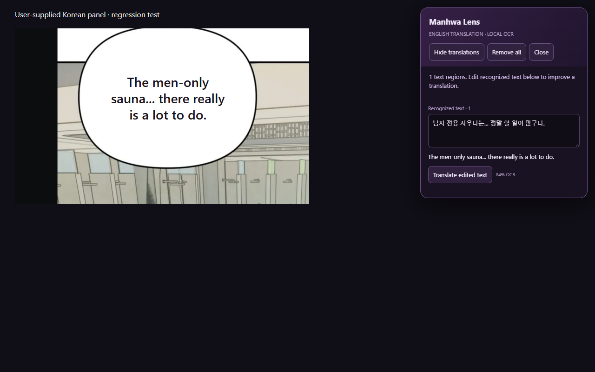
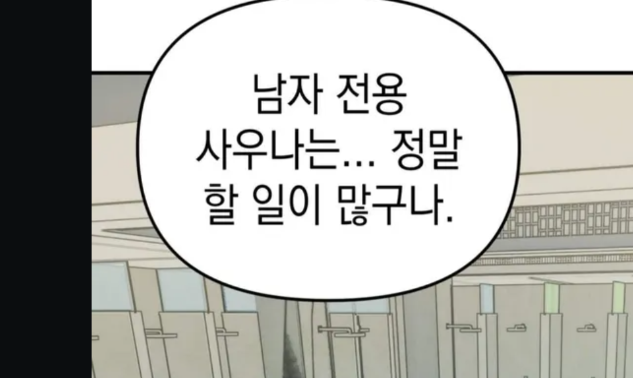
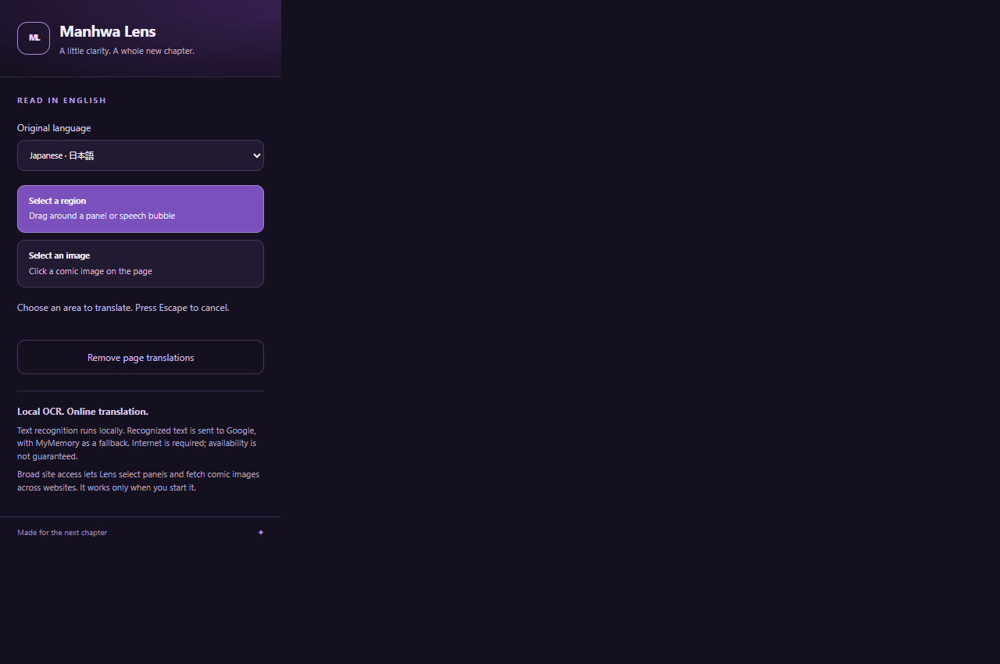
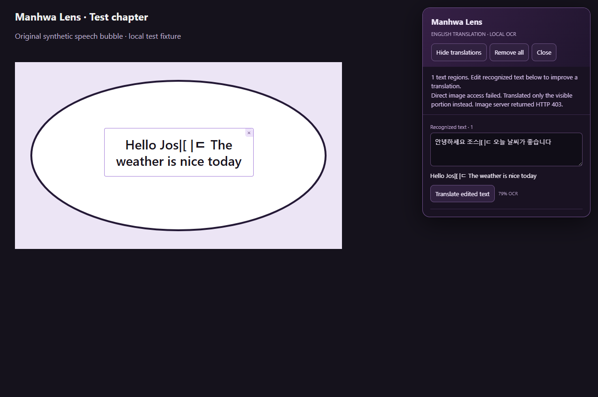

<div align="center">

# 📖 Manhwa Lens

**Translate Korean Manhwa, Japanese Manga, and Chinese Manhua into English in real time.**  
*Free, open-source Chrome/Edge extension with 100% local WASM OCR, smart speech-bubble detection, and zero API keys.*

[](https://developer.chrome.com/docs/extensions/mv3/intro/)
[](LICENSE)
[](https://github.com/naptha/tesseract.js)
[](https://playwright.dev/)
[](#-privacy--security)
[](CONTRIBUTING.md)

<br/>



</div>

---

## ⚡ Overview

**Manhwa Lens** is an unpacked browser extension built for comic readers. Whether you're catching up on raws or browsing untranslated chapters on Webtoons, Naver, Kakao, or manga aggregator sites, Manhwa Lens overlays readable, clean English text directly over speech bubbles without altering the underlying artwork.

All character recognition runs **100% locally on your device** via WebAssembly. Your screenshots and images **never** touch a third-party image server.

---

## ✨ Before & After

| Original Korean Panel | Manhwa Lens Overlay & Transcript |
| :---: | :---: |
|  |  |
| *Raw Korean dialogue in speech bubble* | *Clean English overlay + sidebar transcript* |

---

## 🚀 Key Features

- 🧠 **100% Local WASM OCR:** Ships with bundled Tesseract.js 7.0 and high-accuracy trained models (`kor`, `jpn`, `chi_sim`, `eng`). No external cloud OCR APIs or Python servers required.
- 🛡️ **Speech Bubble Isolation & Noise Rejection:** Sophisticated layout analyzer (`ocr-layout.mjs`) filters out screentones, dark background artwork, locker tiles, and visual artifacts to prevent false-positive boxes.
- 💬 **Sentence Grouping:** Rather than splitting multi-line dialogue into broken fragments, lines within the same bubble are merged into a single coherent sentence before translating.
- 🔤 **Smart Typography Overlays:** Translated English text dynamically scales its font size to fit neatly inside the bubble with centered alignment and crisp contrast.
- ⚡ **Multi-Tier Translation Engine:** Uses an unofficial Google web endpoint with automatic Chrome Dictionary and MyMemory community fallbacks. Includes rate-limit protection and request throttling.
- 🛡️ **Protected & CORS Image Fallback:** If a site blocks direct image downloads (`403 Forbidden`, hotlink protection, canvas tainting), Manhwa Lens automatically falls back to an instant visible-region screenshot capture.
- ✏️ **Interactive Sidebar Transcript:** View recognized original text alongside English translations and confidence scores. Easily edit misread stylized characters and click *"Translate edited text"* for an instant re-fetch.
- ⌨️ **Keyboard Friendly:** Press `Escape` anytime to cancel area selection. Toggle translations on and off with a single click.

---

## 📸 Screenshots

<div align="center">
  <table>
    <tr>
      <td align="center"><b>Toolbar Popup</b></td>
      <td align="center"><b>Hotlink / CORS Screenshot Fallback</b></td>
    </tr>
    <tr>
      <td></td>
      <td></td>
    </tr>
  </table>
</div>

---

## 📥 Installation

Manhwa Lens is distributed as an unpacked Manifest V3 extension. You can install it on **Google Chrome**, **Microsoft Edge**, **Brave**, **Arc**, or **Opera** in under 60 seconds.

### Quick Install (Pre-built Release)

1. **Download** the latest release [`Manhwa-Lens-1.1.0.zip`](Manhwa-Lens-1.1.0.zip) from this repository.
2. **Extract** the ZIP into a permanent folder on your computer (e.g. `Documents/Manhwa-Lens`).
3. Open your browser's extension page:
   - **Chrome / Brave / Arc:** `chrome://extensions`
   - **Microsoft Edge:** `edge://extensions`
4. Toggle **Developer mode** (top-right corner).
5. Click **Load unpacked** (top-left button).
6. Select the extracted `manhwa-lens` folder (the one containing `manifest.json`).
7. Click the **Puzzle icon** (🧩) on your browser toolbar and **Pin** 📌 **Manhwa Lens**.

---

## 🎮 How to Use

1. Navigate to any chapter page on a comic or manhwa website.
2. Click the **Manhwa Lens icon** (ML) in your browser toolbar.
3. Select your **Original Language**:
   - `Korean · 한국어` *(default)*
   - `Japanese · 日本語`
   - `Simplified Chinese · 简体中文`
   - `English`
4. Choose your capture mode:
   - **Select a region:** Click and drag a box around a speech bubble or dialogue panel. *(Best for canvas, background images, or tight speech bubbles).*
   - **Select an image:** Click directly on an `` tag in the reader.
5. Watch the English translation overlay appear inside the speech bubble!
6. Click **Hide translations** to peek at the original art, or click **Remove all** when you are done reading.

---

## 🛠️ Architecture & Under the Hood

```
┌─────────────────────────────────────────────────────────────┐
│                       Browser Tab                           │
│  ┌───────────────────────┐       ┌───────────────────────┐  │
│  │     Webpage DOM       │       │    Manhwa Lens UI     │  │
│  │   (Comic Panels)      │       │ (Shadow DOM Overlays) │  │
│  └───────────▲───────────┘       └───────────▲───────────┘  │
└──────────────┼───────────────────────────────┼──────────────┘
               │ Content Script (content.js)   │
               ▼                               ▼
┌─────────────────────────────────────────────────────────────┐
│             Background Service Worker (background.js)       │
│    - Tab capture (chrome.tabs.captureVisibleTab)            │
│    - Bounded image fetching & 403 fallback orchestration    │
│    - Offscreen lifecycle management                         │
└──────────────────────────────┬──────────────────────────────┘
                               │ chrome.runtime.sendMessage
                               ▼
┌─────────────────────────────────────────────────────────────┐
│                 Offscreen Document (offscreen.js)           │
│  ┌─────────────────────────┐     ┌───────────────────────┐  │
│  │   Local Tesseract WASM  │     │  Multi-Tier Translate │  │
│  │   - LSTM Engine         │     │  - Google Web Client  │  │
│  │   - Model Loader        │     │  - Dict API Fallback  │  │
│  │   - ocr-layout Analyzer │     │  - MyMemory Fallback  │  │
│  └─────────────────────────┘     └───────────────────────┘  │
└─────────────────────────────────────────────────────────────┘
```

1. **`background.js` (Service Worker):** Handles message dispatch, captures visible tabs when needed, and controls the offscreen worker.
2. **`content.js` (Injected UI):** Runs in an isolated Shadow DOM (`#manhwa-lens-root`) so comic site styles never clash with the extension. Tracks window scrolling and resizing to anchor translations in real time.
3. **`ocr-layout.mjs` (Layout Engine):** Performs luminosity sampling and heuristic clustering to identify true speech bubbles, deduplicate multi-tile captures, and group lines.
4. **`offscreen.js` (OCR & Translation):** Hosts the heavy WebAssembly runtime outside the active tab, decoding images and executing multi-tier translation calls with memory caching.

---

## 🔒 Privacy & Permissions

Manhwa Lens is designed with privacy as a first principle:

| Permission | Why It's Needed |
| :--- | :--- |
| `activeTab` & `scripting` | Enables the region-selection crosshair and renders overlays only on the tab you explicitly activate. |
| `offscreen` | Required in Manifest V3 to execute WebAssembly OCR and Canvas image decoding without freezing the UI. |
| `storage` | Remembers your selected language preference across sessions. |
| `<all_urls>` | Allows fetching comic images across diverse CDNs/subdomains without CORS failures, and enables viewport capture on reader sites. |

- ❌ **No Analytics or Trackers:** Zero telemetry, logging, or third-party tracking scripts.
- ❌ **No Cloud Image Uploads:** Images stay entirely inside your browser's local memory.
- 🌐 **Translation Text Only:** Only the extracted text string is sent to the free translation endpoints.

---

## 💻 Development & Building from Source

### Prerequisites
- [Node.js](https://nodejs.org/) v22+
- [pnpm](https://pnpm.io/) v9+
- Python 3.10+ (for icon generation and packaging scripts)

### Setup & Build

```bash
# 1. Clone the repository
git clone https://github.com/dag-bag/manhwa-lens.git
cd manhwa-lens

# 2. Install dependencies (skipping postinstall scripts)
pnpm install --ignore-scripts

# 3. Build the extension package
pnpm build

# 4. Install Playwright browser dependencies (for testing)
pnpm exec playwright install chromium
```

The compiled unpacked extension will be generated in `dist/manhwa-lens`.

### Running Tests

```bash
# Run unit tests (geometry, layout, caching, translation mocks)
pnpm test

# Run regression test on the real Korean panel fixture
pnpm test:panel

# Run full Playwright headless browser integration test suite
pnpm test:browser
```

---

## 📁 Repository Structure

```text
manhwa-lens/
├── assets/                    # Showcase screenshots and fixture previews
├── dist/                      # Ready-to-load unpacked extension build
│   └── manhwa-lens/           # Built extension (manifest.json, wasm, models)
├── extension/                 # Source code for the extension
│   ├── background.js          # Service worker coordinator
│   ├── content.js             # Shadow DOM UI & selection overlay
│   ├── core.mjs               # Geometry, clipping & parsing utilities
│   ├── ocr-layout.mjs         # Bubble detection & artwork noise filtering
│   ├── offscreen.html/js      # Offscreen worker for local Tesseract WASM
│   ├── popup.html/css/js      # Toolbar popup interface
│   └── manifest.json          # Manifest V3 specification
├── scripts/                   # Build and packaging automation
│   ├── build.mjs              # Asset bundler & model checksum verifier
│   ├── icons.py               # PIL icon generator
│   └── package.py             # Verified ZIP release packager
├── tests/                     # Automated test suites
│   ├── browser.mjs            # End-to-end Playwright browser suite
│   ├── core.test.mjs          # Unit tests for geometry & validation
│   ├── ocr-layout.test.mjs    # Unit tests for bubble grouping
│   ├── translation.test.mjs   # Unit tests for translation fallbacks
│   └── user-panel.mjs         # Real-world manhwa panel regression test
├── LICENSE                    # MIT License
├── package.json               # Scripts & dependencies
├── README.md                  # Project documentation
└── TEST-RESULTS.md            # Detailed automated test report
```

---

## 🤝 Contributing

Contributions are warmly welcome! Whether it's adding support for new languages, improving speech-bubble segmentation heuristics, or optimizing translation latency:

1. Fork the Project
2. Create your Feature Branch (`git checkout -b feature/AmazingFeature`)
3. Commit your Changes (`git commit -m 'Add some AmazingFeature'`)
4. Run the test suites (`pnpm test && pnpm test:panel`)
5. Push to the Branch (`git push origin feature/AmazingFeature`)
6. Open a Pull Request

Please read our [Contributing Guidelines](CONTRIBUTING.md) for more details.

---

## 📄 License

Distributed under the **MIT License**. See [`LICENSE`](LICENSE) for more information.

Third-party libraries and model weights:
- [Tesseract.js](https://github.com/naptha/tesseract.js) (Apache 2.0)
- [Tesseract Core](https://github.com/naptha/tesseract.js-core) (Apache 2.0)
- [Tesseract Traineddata](https://github.com/tesseract-ocr/tessdata) (Apache 2.0)

---

<div align="center">
  <sub>Made with 💜 for comic and manhwa enthusiasts worldwide.</sub>
</div>
